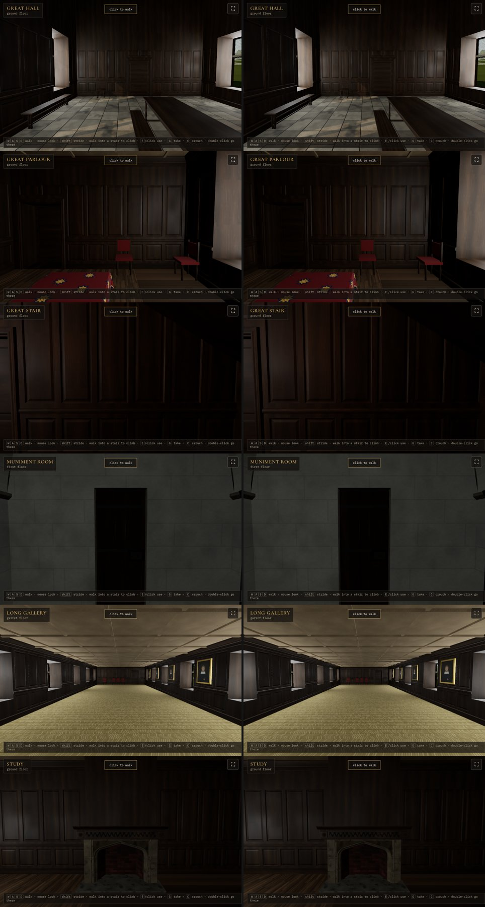

# Timber grain keyed by address (gate g3b7af2, point 1): ready on this branch, waiting on your eye

**What it is:** every timber board drew its grain (a shift and scale of the oak texture, a slight slope, a tone) from one shared stream, `rng(1660)`, in build order. So building the rooms in any other order (in workers, room by room, from a cache) would redraw every board. Now each board draws from a stream keyed by where it is:
- a thing's parts: the thing's own address (`src/make/build.js`; the press's drawers their own);
- a wall's panelling: its room and wall (`grain/<room>/<wall>`);
- a ceiling's beams, a door's lining, a stair's timbers: their room, door or stair.

Pages outside the manor (the lab's single rooms) keep the shared stream.

**What changes in the look:** the same kind of variation, drawn again. Left today, right this branch; about 2 of 255 average per room, the grain's character unchanged (the great hall's right window differs only by when the outside backdrop loaded).

**What it proves (all four houses: manor, case, banqueting house, Alice's hall):**
- positions, normals and indices identical to today; only uv and colour change;
- built in plan order, reversed and shuffled (`?order=reverse|shuffle`), every mesh comes out the same (an order-blind digest over every attribute);
- the control: with the shared stream forced back, reversing the order changes all four houses, so the test catches the old fault;
- the outside's windows are now merged in plan order whatever order the rooms were built in (they had followed build order);
- suites (checks, manor, geometry, determinism): 112 passed.

**Still in build order, for point 2:** the lists the build returns (things, blocks, hearths, flames) hold the same entries in any order but list them in build order. Building in workers will assemble them in plan order.
