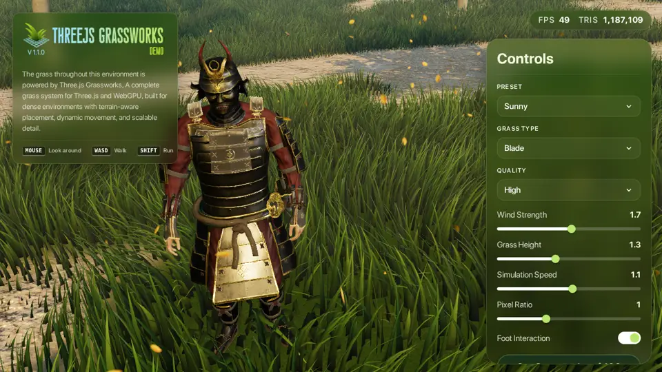
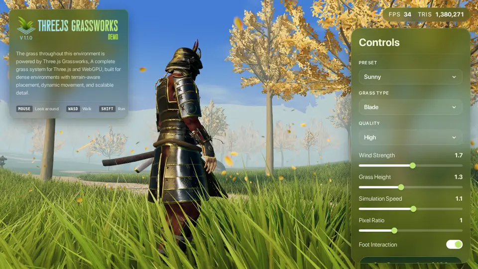

# Grassworks and open grass: techniques banked (2026-10-11)

**Kabe, 2026-10-11:** "Alright I want you to reach deep into this and identify improved quality and performance systems from this it also includes by its nature good deployable grass which we need. Reach deep get what we can https://grassworks.techredux.co/demo"

**My reading:**
- **Grass is needed.** The fresh-eyes audit's top miss was "no grass", and it sits in R69.
- **Grassworks is a paid product,** $100 one-off with full source under a commercial licence. Its code is deliberately obfuscated and its notice forbids reuse.
- **So the deep reach had three legs:**
  1. the demo, measured;
  2. its public docs (what it does, in its own words);
  3. the open prior art its methods come from.
- **Nothing of its code or assets was opened, copied or kept.** Buying it is Kabe's call (gate g640c2a; the default is to build our own, nothing bought).

**Files:**
- [docs.md](docs.md): what its 26 docs pages disclose, including its defaults and 12 presets.
- [prior-art.md](prior-art.md): 16 open and published sources, each with its licence, technique, cost and verdict, and a recommended design for us.

 

## The demo, measured (2026-10-11, headless Chromium on this desktop's GPU, 1280×720)

- **Load:** 30 MB, the start button at about 13.6 s. Of that, 11.5 MB is the environment's models, 4.3 MB is audio, 2.3 MB a physics engine (Rapier) and 1.5 MB an HDR sky. Shader compiling shows on the loading screen.
- **The whole demo's frame** (grass, a samurai character, trees, sky), at its four quality levels:

| grass type | Performance | Balanced | High | Ultra |
|---|---|---|---|---|
| Blade | 17.0 ms · 0.80 M tris | 18.9 ms · 0.87 M | 20.0 ms · 1.19 M | 27.6 ms · 1.66 M |
| Billboard | 18.2 ms · 0.75 M | 21.0 ms · 0.77 M | 21.6 ms · 0.80 M | 28.2 ms · 0.83 M |

- **Phone-shaped page** (390×844 at 3×, same GPU): 17.7–31.3 ms; that GPU says nothing about a real phone.
- **The cost:** 0.8–1.7 M triangles a frame is far past a phone's 33 ms budget. It is beautiful, and it is not built for phones.
- **Billboards cost as much as blades.** Alpha-tested cards draw many overlapping pixels and switch off the phone GPU's hidden-pixel saving.

## What it does, from its docs (ideas worth taking)

1. **Detail drops without popping.** Each lower level keeps a subset of the blades above it, so they don't move, and the hand-over is dithered across a narrow band.
2. **The far edge is a circle.** A fade over the last 8 % of range, so the tile grid never shows.
3. **Four distance bands,** ending at 0.6, 0.7, 0.9 and 1.0 of the range; blade density 4/2/1/1 and segments per blade 4/2/1/1.
4. **Tiles follow the camera,** a fixed size, one draw each, culled by the CPU (it seems: nothing points to GPU culling).
5. **The ground captured from above once,** and blades placed from that capture, not from the mesh, so a coarse ground still places finely.
6. **One grayscale map** gives both coverage and height: paths, clearings, worn edges.
7. **A trail map that follows the camera,** 256², with actors stamped in as spheres and grass recovering a little each frame.
8. **Cheap shading:** a colour ramp from root to tip with noise, gloss at the tip, a darkened root standing in for contact shadow. Grass receives shadows and casts none.
9. **Twelve presets as a tuning table.** Real species use gentle wind with fine flutter; the cinematic looks use strong wind with large gusts. Units need rescaling to metres.

## What we build: our own grass for R69 (from prior-art.md; estimates, not yet measured)

1. **Placement from the ground generator, deterministic.**
   - The generator paints a ground map at 0.25 m: density, kind, height and wear.
   - Paths, walls, furniture and shade are drawn into it as soft masks.
   - A blade grows where a fixed blue-noise point's threshold falls under density × tier (Horizon Zero Dawn's method). So the phone's blades are a subset of the desktop's, and editing one mask disturbs nothing nearby.
   - Each 4 m tile of points is turned or mirrored by its world position, so the pattern never repeats every 4 m.
   - The same rank grows grass in blade by blade where the holodeck grid gives way to established ground.
   - Nothing is stored per blade: each blade's attributes are hashed from its position.
2. **A check, cheap and coherent (standing approval):** the map is zero inside every footprint, so no grass grows through a floor, a wall or a table.
3. **Blades:** a curved (Bézier) blade, with lean, facing and colour shared across clumps (Ghost of Tsushima). Lawn 5–15 cm, meadow 25–60 cm, and a second shape for weeds.
4. **Distance bands, desktop / phone:** 11 vertices out to 8 / 5 m; 5 vertices out to 20 / 12 m with 1 blade in 4 kept, each survivor 4× the area so the field doesn't thin; one triangle out to 40 / 25 m, meadow and weeds only. Blades shrink at each band's edge so nothing pops, the band thresholds follow the band densities, and edge-on blades are thickened.
5. **Culling:** the CPU tests 8 m chunks against the view, one instanced draw each, about 30–60 in all; rejected blades collapse in the vertex shader. Per-frame CPU work follows the chunks seen, never all the chunks kept. A compute pass with indirect draws, on WebGPU only, gets added only if it measures faster. (The WebGL2 fallback in r186 has neither indirect draws nor compute atomics.)
6. **Wind:** one shared function of position and time, also used by trees and hedges (Teleoperator bank §look 7): three rotated octaves plus gusts, with clumps swaying together.
7. **The trail:** 256² over 32 m around the player. The CPU stamps only where feet are; the fade over about 6 s is worked out in the shader, so no pass runs over the whole map (Grassworks' costs 1.6 ms a frame). Lasting wear lives in the world document.
8. **Shading** (where most of grass's GPU time goes: a flat colour removed 58–84% of Grassworks' blade cost), with grass's own small lighting function, not the standard material:
   - the root-to-tip ramp with a clump tint;
   - normals rounded across the blade, and bent toward the ground's with distance;
   - ambient from the same sky or probe as the ground;
   - backlight translucency from the real sun;
   - specular fading out by about 15 m, since with no TAA it would sparkle;
   - darker roots, and the static shadow sampled at the root;
   - lighting per vertex on phones.
9. **Far field:** the ground shader paints tufts, dry patches and mowing stripes with the blades' own colour function, so the hand-over doesn't show.
10. **Budget to verify:** about 0.6–1.0 ms on a desktop GPU, 1.5–2.5 ms of a phone's 33 ms frame. Nothing downloaded. Grassworks' blades measured 1.25–2.17 ms on an entry-level desktop GPU, and the cost follows grass pixels, so our figure waits on R50's measurement at walking height.

**Revised 2026-10-11** from the colony's Grassworks report, which dissected and measured Grassworks at Kabe's direction (tile repeat, survivor widening, the trail's decay, the band ladder, shading cost). Details and section references are in [prior-art.md](prior-art.md). We build from that report and open sources only.

**Open code we may borrow from, with credit (each passes a safety pass first):**
- Bruno Simon's folio-2025 (MIT): one triangle per blade, coloured by the terrain's own function.
- SimonDev's Quick_Grass (MIT): the normal-rounding and edge-thickening formulas.
- Matthew Kissinger's threejs-field-grass (MIT, young): quality tiers that are subsets of one another, and a CPU-written trail.

**Ideas only** (no licence, or proprietary talks): al-ro's GitHub copy, Nitash Biswas, grass-webgpu, Ghost of Tsushima, Horizon Zero Dawn, Grassworks.

## Decisions waiting on Kabe

- **g640c2a:** buy Grassworks, or build our own? Default: build our own; nothing bought.
- **gdb4075:** grass straight after M7's checkpoint, ahead of M8's people? Default: yes; M7 finishes first.
