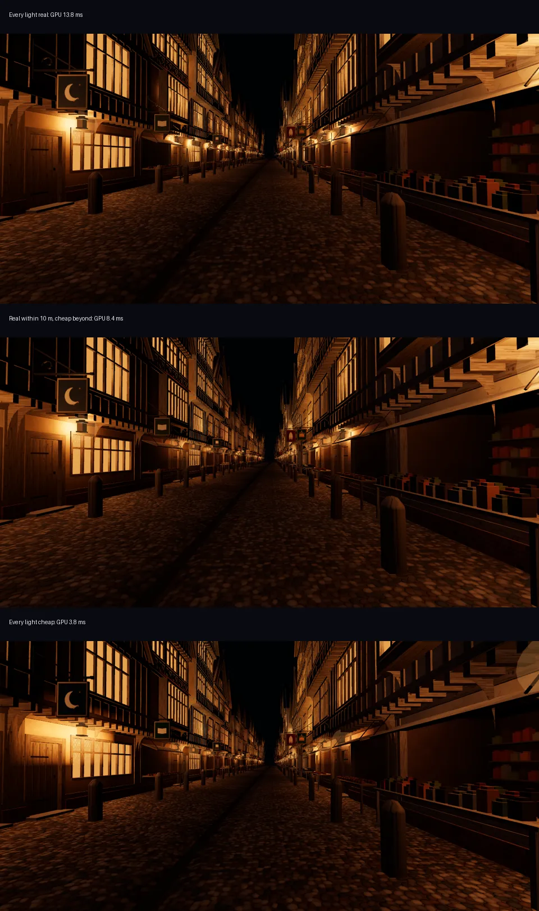

# Many lights at night: the bench (2026-10-11)

**Kabe, 2026-10-11**, in order:
- "Also lights in front of windows dont lick in until I approach them and it looks weird currently"
- "What matters is light sources that effect what the user sees … not weird at worst and even better if its good/great"
- "we dont want the end of the street lights to turn on as we approach. Light specifically needs a low resolution approx manifest if its in vision. Otherwise dont render it if the source or cast isnt in frame"
- "Yeah cheap render if we arn't close for sure"
- "London street at night, extra long each window having an internal light source and street lamps going down is a good test. Have MANY light sources, lock in high fidelity for all, consider cheapest approximation render for all, compare quality overall against each other, then where the quality cutoff in distance isnt too noticeable cut over to cheap. Then play with that radius to optimize fps without drastic quality loss"
- "For cheap lighting can we just calculate once effective from light source to effected elements and lock those elements complete brightness to the average of that light source then when cutoff hits it really renders?"

**My reading:** three tiers. Real light near you. A cheap light, computed once and locked, for anything farther that is in frame. Nothing for a light whose source and cast are both out of frame. The handover between real and cheap must not show. The radius is set by measurement.

**The page:** `lab/fps/night.html`, the London street (`src/make/street.js`) at night.
- **The street:** 400 m long, with a light 0.4 m inside each of its 838 front windows and a lantern at each of 130 doors: 968 lights.
- **How each light shows:** every source shows itself the same way in every mode (glowing glass; a lantern's flame and halo). So the modes differ only in the light each source casts.
- **The prior art behind it:** [prior-art.md](prior-art.md).

## The tiers

- **Real:** a point light per source, through three r186's `ClusteredLighting` (Forward+; WebGPU only). It covers specular and the exact falloff.
- **Cheap, worked out once and locked** (your "calculate once"):
  - Every source's light is summed into three's own `LightProbeGrid`: L2 spherical harmonics on a grid, 1 m across and up, 2 m along the street.
  - It is filled by arithmetic from the lights, with no render bake: L_lm = E·Y_lm(l), with E as three attenuates a point light.
  - Every material samples it, at one lookup per pixel however many lights there are.
  - Light on a surface keeps its direction (a wall facing away from a lamp stays dark). I didn't use one brightness per object, because one merged mesh here is a whole stretch of house fronts.
- **The handover:**
  - Within R of you a source is fully real; beyond R + 4 m, fully in the grid; across the band, part each, in quarter steps.
  - A source's real share is always 1 − its grid share, so it is never lit twice or lost.
  - Real lights come from a fixed pool (192), so the light list never changes and nothing recompiles.
  - Each frame, the sources furthest from their share move first, within 3 ms. Only the grid slices they touch go to the GPU.

## Measured (this desktop's GPU, 1280×720, dpr 1, two views, GPU ms from WebGPU timestamps)

| Mode | GPU ms | Real lights on | Mean difference from all-real, by distance (0–255) |
|---|---|---|---|
| All real | 11.6–13.8 | 968 | none |
| Real within 20 m | 10.1–12.6 | ~105 | none to 20 m; 8–14 beyond |
| **Real within 10 m** | **6.9–8.4** | ~50 | **none to 10 m; 3–4 at 10–15 m; 8–14 beyond** |
| Real within 5 m | 4.9–6.3 | 12–20 | none to 5 m; 4–10 at 5–10 m |
| All cheap | 3.2–3.8 | 0 | 7–17 everywhere |

- **The cheap tier's error:**
  - It is about 10 of 255 on average past 10 m, in a quarter to a third of pixels. That is the sharp pools and the glints that a 1–2 m grid smooths over.
  - Its average brightness is right to within ±6.
  - Fog and distance hide most of it: at 10 m the side-by-side above is hard to tell apart.
- **Walking 60 m at 10 m:** 1 frame in 100 slower than 19–20 ms, against 18 with all real or all cheap. Each source moved in about 1 ms, with no stalls.
- **Lessons on the way:**
  - **Adding and removing lights is costly:** taking lights in and out of the scene recompiled every shader, a 1.6 s stall, hence the pool.
  - **Grid updates:** whole-grid rebuilds cost 0.5 s and full uploads stuttered. Hence the incremental shares and the slice uploads.
  - **Texture size:** a grid laid along the 3D texture's depth went past WebGPU's 2,048 limit and silently failed to exist. It is guarded now.
  - **Window lights:** a light in front of the glass lit its own wall, which a lamp in a room can't do, and made the grid look 20% dark. The lights now sit inside the room.

## The swap, on a phone's budget (2026-10-11, the monitor for Kabe: "if a newly close light matters more than the least-needed real one, swap them (with a fade). Check it on the phone budget (~4 real lights)")

- **The rule:** when the real lights are all in use and a waiting light needs one more than the least-needed holder does, the holder fades into the grid over 0.5 s and the slot passes on. "Needs more" means a higher real share, or the same share and over a metre nearer.
  - Waiting lights take freed slots nearest first.
  - There are never more lights fading out than are waiting.
  - The holder's real and grid shares still sum to the source throughout.
- **Measured:** 4 real lights, 10 m radius, after walking 40 m. The pool size is a phone's, but this desktop's GPU ran it, so these are not phone timings.

| | Swap | No swap (wait for a free slot) |
|---|---|---|
| The 4 real lights' distances | 4.3, 4.8, 5.3, 6.4 m | 4.3, 9.7, 9.9, 10.7 m |
| The 4 nearest | 4.3, 4.8, 5.3, 5.7 m | the same |
| Difference from all real, 0–5 m / 5–10 m (of 255) | 0.6 / 3.3 | 7.5 / 15.0 |
| Walking, 1 frame in 100 | 19.3 ms | 18.7 ms |
| Swaps over 40 m | 23 | 0 |

- **First try, which failed:** it churned. Freed slots went to whichever waiting light came first in the list, so it was soon evicted again; once, all four were fading out at the same moment. Hence the nearest-first order and the cap.

## Recommendation

- **Desktop with WebGPU:** real within 10 m, cheap beyond. That is about 40% less GPU than all real, and exact wherever you look closely.
- **Phones** (not measured yet; R50):
  - `ClusteredLighting` needs WebGPU, so on the WebGL2 fallback the near tier is a small fixed pool of ordinary lights, about 4. `DynamicLighting` is the r186 way to keep that pool without recompiles.
  - The grid wants half floats and a packing step there, since few phone GPUs filter 32-bit float textures.
  - The radius will be nearer 5 m.
- **The manor:** the same three tiers would end the window light that kicks in as you approach (fixed today by merging windows into runs and the in-frame gate, `src/make/lightpool.js`). The manor's grid is R68's probe grid, filled the same way. This bench shows the method; using it in the manor waits on R68.
- **Next on this bench, if you want them:**
  - phone numbers;
  - cheap glow for distant lanterns (fog scattering in the halo);
  - finer grid cells near house fronts, to close the 10-of-255 gap.

## Far away, and the hour (2026-10-11)

The far-view test and the time of day are in [tiers.md](tiers.md):
- the town from 2 km in, with each handover measured;
- far points, the grid from 1.5 km, and real lights within 10 m;
- why the points-to-glass handover can't fully meet the mark;
- the sun and moon by the hour.
