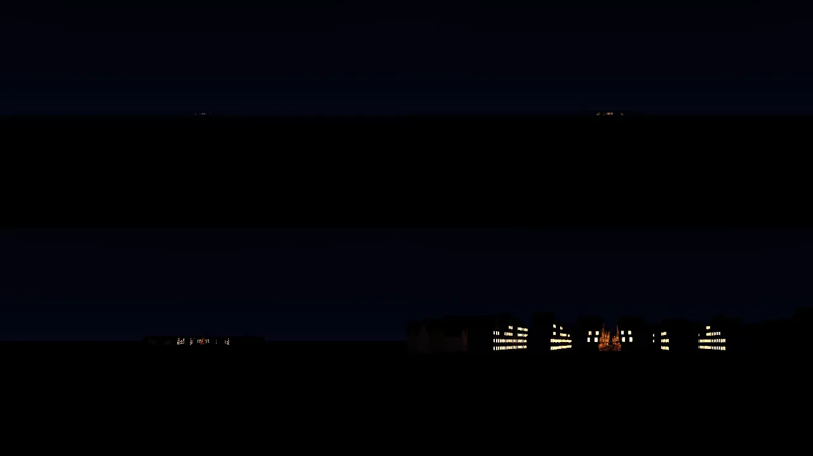
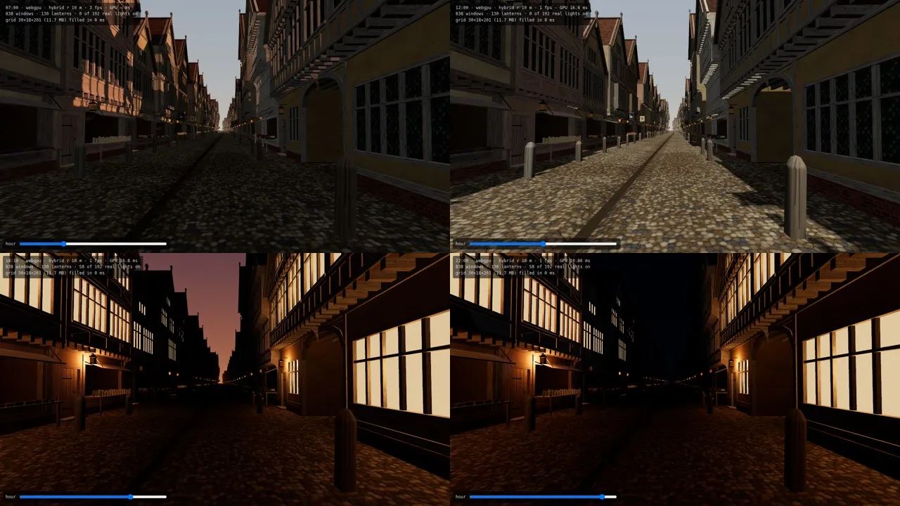

# Lights in three tiers: banked for R68 (2026-10-11)

**What this is:** the design for every light in a place: windows, lanterns, candles and fires. It was measured on the night bench, `lab/fps/night.html` (the London street at night, 968 lights), and is banked for R68 ("light that bounces") and for whichever place first lights its night.

**Kabe's words:**
- "Light specifically needs a low resolution approx manifest if its in vision. Otherwise dont render it if the source or cast isnt in frame."
- "cheap render if we arn't close for sure"
- "For cheap lighting can we just calculate once effective from light source to effected elements and lock those elements … then when cutoff hits it really renders?"

**The monitor's finish line, for him:** "each handover (far points → grid → real lights) measured as on the street … done when each handover is under the street's visible-difference mark and the radii are recorded, or when you can say which handover can't get there and why."

## The tiers

| Tier | From | What draws it | Cost |
|---|---|---|---|
| **Far points** | beyond 1.5 km (fading in from 1 km) | each window or lantern as one sprite of its own light; never under 1.5 px; as wide as its window faces you; fogged; all in one draw | flat, ~0 |
| **Grid** (cast light, worked out once and kept) | the place within 1.5 km | every source summed into three's `LightProbeGrid` by arithmetic (L2 harmonics), with no bake; it streams in at 3 ms a frame as the place comes within range | one lookup a pixel; 12 MB for a 400 m street |
| **Real** | within 10 m of you (5 m on a phone budget) | a fixed pool of point lights moved between sources: 192 on desktop, about 4 on a phone | per light, per pixel |

**The rules across tiers:**
- **The sum stays whole:** a source's real share plus its grid share is always 1, so nothing is lit twice or lost.
- **Moves are budgeted:** shares move in quarter steps, within 3 ms a frame, and only the touched grid slices are uploaded.
- **The swap:** when the pool is full, a light that needs a slot more than the least-needed holder takes it. The holder fades out over 0.5 s, and freed slots go nearest first.
- **Out of frame:** a light whose source and cast are both out of frame holds no real slot (the manor's pool, `src/make/lightpool.js`).
- **The hour scales everything:** at dawn every tier's lamps go out together, and at dusk they come on together.

## The handovers, measured

**The method:**
- Two views: side-on to the town, and up the street. The side view is mostly hidden by the near houses, so the street view is the one that counts.
- 11 distances, from 2 km to 50 m.
- **The comparison:** each tier against the next, over the pixels the town's lights change. The difference is averaged in linear light with a 1.5 px blur, because sub-pixel lights compared pixel by pixel measure only aliasing. The truth is a 3× render averaged as light.
- **The mark,** from the street's own handover: about 4 of 255 on average, with under 10% of pixels changing by more than 10.

| Handover | Where | The change at the handover | Under the mark? |
|---|---|---|---|
| Grid → real | 10 m | 2.5–3.6 average, 4–9% over 10 (street, 10–15 m band) | **yes** |
| None → grid (cast light on) | 1.5 km | not measurable at 1.5 km (no pixel changes); at 1 km it would be 3.9 average, 17% over 10 | **yes, at 1.5 km** |
| Points → glass | 1–1.5 km blend | 1.0 at 2 km; 4.6 (15%) at 1.5 km; 5.9 (20%) at 1 km | **borderline, and it leaves twinkle; see below** |

**Why the first handover can't fully get there:**
- **What still pictures show:** against the 3× truth, the glass alone is within about 5 at every distance (blurred). The points match only beyond about 1.5 km. At 250–700 m they are 11–15 off, because a window 2–5 px across reads by its mullions and frame, and a single point can't carry those.
- **What moving shows** (how much the town's total light jumps per frame, drifting 2 m sideways):

  | Distance | 3× truth | Glass | Points |
  |---|---|---|---|
  | 2 km | 13% | 23% | 3% |
  | 1 km | 14% | 17% | 2% |
  | 500 m | 2% | 11% | 1% |
  | 250 m | 2% | 3% | 1% |

- **So no single distance gives both:** where the points stop the glass twinkling (250–500 m), the two differ by 12–15 on still pictures. Where they agree on still pictures (1–1.5 km), the glass still twinkles from 500 m to 1 km. I placed the handover at 1–1.5 km.
- **The fix, not built:** glass that never rasterises smaller than a pixel. That is a glass quad grown to a pixel in the vertex shader, with its glow scaled down by the same factor, keeping its true shape and place. It would end the twinkle without a separate point tier between 250 m and 1.5 km.

**Brightness of the points:**
- They are calibrated against the 3× truth with one gain of 1.2. Their light is then 0.91–0.99 of the truth's beyond 1 km and 0.76–0.93 nearer.
- **The early mismatches were my errors:**
  - a 1× lamps-off picture subtracted from the 3× truth;
  - sprites facing the camera at full size although the windows are seen edge-on;
  - half of each sprite cut into its own wall.

**Flying in from 2 km at 50 m/s** (r = 10 m, every default):
- Frame time: half of frames 16.7 ms, 1 in 100 slower than 19.7 ms.
- Worst frames: the first (229 ms, compiling) and one at 615 m (47 ms).
- The grid filled between 1,500 and 1,250 m.

**GPU, this desktop:** from 2 km, every light real costs 1.8 ms, the same as the grid. The town is a few pixels, so clustered lighting's culling handles it. But clustered lighting keeps at most 128 lights per screen tile, so from far away it drops some of a distant town's lights. The grid doesn't.

## The hour

- One set of values for the whole look, blended as the hour moves (engine principle 5):
  - one key light, the sun by day and the moon by night, with one shadow map following you in 25 m steps;
  - a sky with sun disc and glow, moon and stars;
  - horizon colour as fog, and fog density by hour (London's sea-coal haze by day, clearer by night);
  - exposure;
  - every lamp scaled by the hour.
- The slider, `[` and `]`, or `?hour=` change it on the bench.
- It serves R69 ("fires and sky that read as fire and sky") and the "hour of the case" in the Teleoperator bank.

## For R68

1. **The manor's probe grid is this grid,** filled from the room's lights by arithmetic, and the R68 bounce on top. `src/make/light.js` bakes by rendering cubemaps; arithmetic fill is milliseconds, and it updates per light when a candle is lit or a shutter closed.
2. **Real lights:**
   - On desktop, the pool of `src/make/lightpool.js` becomes clustered real lights within about 10 m, with the swap.
   - On phones, about 4 ordinary lights within about 5 m. Without WebGPU clustering, three r186's `DynamicLighting` keeps the count fixed.
3. **On phones,** the grid needs half floats and a packing step, because few phone GPUs filter 32-bit floats. Its slices are then packed only where touched.
4. **The grid's long axis must lie along the 3D texture's depth,** within 2,048 texels ÷ 7. The manor is small; a long street needs 2 m cells along it.
5. **Not measured yet:**
   - phones;
   - the glass that never draws under a pixel (the fix above);
   - a town's sky glow, which is what reads first from far off on a hazy night.
